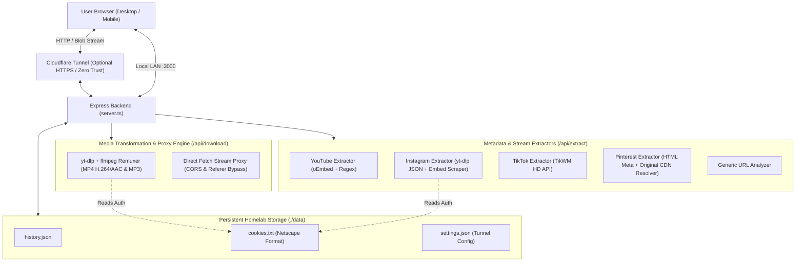
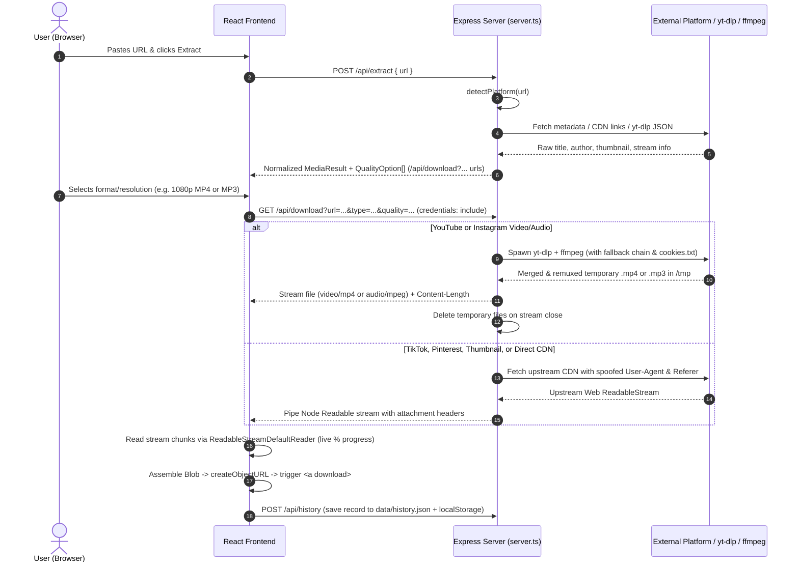

# UV Downloader — Self-Hosted Universal Media Downloader for Homelab

**UV Downloader** is a self-hosted, full-stack media extraction and downloading web application designed for homelabs, desktop, and mobile devices. It takes public or authenticated links from **YouTube**, **Instagram**, **TikTok**, **Pinterest**, or direct media URLs and transforms them into watermark-free, ready-to-save **MP4**, **MP3**, and **high-resolution JPEG/PNG** files.

Built with **React 19**, **Tailwind CSS 4**, **Express**, **`yt-dlp`**, **`ffmpeg`**, and an integrated **Cloudflare Tunnel (`cloudflared`)** manager, it runs in a single container or Node.js process with zero external database dependencies.

---

## Table of Contents

1. [System Architecture](#1-system-architecture)
2. [How a Link Becomes Downloadable Media (End-to-End Pipeline)](#2-how-a-link-becomes-downloadable-media-end-to-end-pipeline)
   - [Phase 1: URL Capture & Platform Detection](#phase-1-url-capture--platform-detection)
   - [Phase 2: Platform-Specific Metadata & Stream Extraction (`POST /api/extract`)](#phase-2-platform-specific-metadata--stream-extraction-post-apiextract)
   - [Phase 3: Media Processing, Remuxing & Streaming Proxy (`GET /api/download`)](#phase-3-media-processing-remuxing--streaming-proxy-get-apidownload)
   - [Phase 4: Client-Side Stream Assembly & History Persistence](#phase-4-client-side-stream-assembly--history-persistence)
3. [Deep Dive: Platform Extraction Strategies](#3-deep-dive-platform-extraction-strategies)
   - [YouTube & YouTube Shorts](#youtube--youtube-shorts)
   - [Instagram (Reels, Posts & TV)](#instagram-reels-posts--tv)
   - [TikTok & Douyin](#tiktok--douyin)
   - [Pinterest (Video & Image Pins)](#pinterest-video--image-pins)
   - [Generic / Direct Media Links](#generic--direct-media-links)
4. [Homelab Features: Cookies & Cloudflare Tunnels](#4-homelab-features-cookies--cloudflare-tunnels)
5. [API Reference](#5-api-reference)
6. [Project Structure](#6-project-structure)
7. [Installation & Deployment](#7-installation--deployment)

---

## 1. System Architecture

UV Downloader uses a unified **Express + Vite** server architecture (`server.ts`). In development, Express mounts Vite in middleware mode for instant HMR; in production, Express serves the compiled React SPA from `dist/` alongside the REST and streaming API routes.



---

## 2. How a Link Becomes Downloadable Media (End-to-End Pipeline)

Transforming an arbitrary social media URL into a playable file saved on a user's device happens in **four distinct phases**:



### Phase 1: URL Capture & Platform Detection
1. The user pastes a link into `HeroCapture` (`src/components/HeroCapture.tsx`), which sends `POST /api/extract` with `{ url }` via `extractMedia()` (`src/services/api.ts`).
2. On the server, `detectPlatform(url)` inspects the hostname and path to classify the link into one of five pipelines:
   - `youtube` (`youtube.com`, `youtu.be`)
   - `instagram` (`instagram.com`, `instagr.am`)
   - `tiktok` (`tiktok.com`, `douyin.com`)
   - `pinterest` (`pinterest.com`, `pin.it`)
   - `generic` (any other direct media or web link)

### Phase 2: Platform-Specific Metadata & Stream Extraction (`POST /api/extract`)
Rather than downloading the heavy video file immediately, `/api/extract` resolves metadata (title, creator handle, duration, thumbnail) and constructs a normalized `MediaResult` object containing an array of `QualityOptionItem` entries.
- Each `QualityOptionItem` has a pre-built proxy download URL pointing back to `/api/download?url=...&type=...&quality=...&filename=...&platform=...`.
- When needed (e.g., Instagram), the thumbnail URL itself is also wrapped in `/api/download?...&inline=1` so the browser can render the preview image without being blocked by `Cross-Origin-Resource-Policy: same-origin` headers from Instagram's CDN.

### Phase 3: Media Processing, Remuxing & Streaming Proxy (`GET /api/download`)
When the user clicks **Baixar** (Download) on a specific quality option, `/api/download` executes one of two transformation engines depending on the platform and media type:

#### Engine A: `yt-dlp` + `ffmpeg` Remuxing Pipeline (YouTube & Instagram Video/Audio)
Modern platforms like YouTube and Instagram serve high-definition video (1080p+) as separate adaptive DASH streams (video-only track + audio-only track, often encoded in WebM/VP9 or fragmented MP4). Simply forwarding a raw stream URL would result in silent video or incompatible containers on mobile devices.
1. **Temporary Workspace**: The server creates a unique prefix `/tmp/uv-<timestamp>-<random>.<mp4|mp3>` and registers a `req.on('close')` listener so if the user cancels the download mid-flight, the child `yt-dlp` process is immediately terminated (`SIGTERM`) and partial files are cleaned up.
2. **Format Selection & Remuxing**:
   - **For Video (`mp4`)**: Spawns `yt-dlp` with `-f bv*+ba/b -S res:<1080|720|480>,ext:mp4:m4a,vcodec:h264,acodec:aac --merge-output-format mp4 --remux-video mp4`. This downloads the best video and audio streams matching the requested resolution, prioritizes universally compatible H.264 video + AAC audio codecs, and uses `ffmpeg` to mux them into a single standard `.mp4` container.
   - **For Audio (`mp3`)**: Spawns `yt-dlp` with `-x --audio-format mp3 --audio-quality 0`, extracting the best audio track and transcoding it via `ffmpeg` into a 320 kbps VBR MP3.
3. **Smart Retry & Cookie Fallback Chain**:
   - **YouTube**:
     1. *Attempt 1 (No cookies + strict format sort)*: Runs without cookies first so `yt-dlp` can utilize fast, unthrottled mobile extraction clients (`ios` / `android_vr`).
     2. *Attempt 2 (With `cookies.txt` + strict format sort)*: If the video is age-restricted (+18) or members-only and `data/cookies.txt` exists, retries with `--cookies data/cookies.txt`.
     3. *Attempt 3 (Unrestricted format fallback)*: If strict codec sorting fails, retries without `-S` constraints so `ffmpeg` can remux whatever stream is available.
   - **Instagram**:
     1. *Attempt 1 (With `cookies.txt` + strict format sort)*: Uses `data/cookies.txt` first (if present) to bypass Instagram login walls.
     2. *Attempt 2 (With `cookies.txt` + unrestricted format)*: Retries without strict format sorting if the reel uses non-standard stream layouts.
4. **File Streaming & Auto-Cleanup**: Once `yt-dlp` exits with code `0`, Express stats the resulting file to set an exact `Content-Length` header, sets `Content-Type` (`video/mp4` or `audio/mpeg`) and `Content-Disposition: attachment`, pipes `fs.createReadStream()` to the HTTP response, and deletes the temporary file from `/tmp` as soon as the stream finishes or closes.

#### Engine B: Direct Stream Proxy with Header Spoofing (TikTok, Pinterest, Images & Direct Links)
For platforms where the extractor already resolved a direct CDN stream URL (such as TikTok watermark-free streams, Pinterest `originals` images/videos, or Instagram photo posts):
1. If an Instagram image request still points to a post permalink rather than a `cdninstagram.com` / `fbcdn.net` asset, the server resolves the direct CDN URL on-the-fly via `yt-dlp --dump-single-json`.
2. The server fetches the upstream URL using a desktop Chrome `User-Agent` and platform-specific `Referer` (`https://www.tiktok.com/`, `https://www.instagram.com/`, or `https://www.google.com/`), bypassing hotlink protection and CORS restrictions.
3. **Login-Wall Guard**: Before piping the response, the server inspects the upstream `Content-Type`. If the upstream server returned `text/html` (such as an authentication challenge page) when a `.mp4`, `.mp3`, or `.jpeg` was requested, the server aborts with HTTP `403` and a clear message instructing the user to add their cookies in the Homelab panel—preventing corrupted HTML files from being saved as `.mp4`.
4. The Web `ReadableStream` is converted into a Node stream via `Readable.fromWeb()` and piped directly to the client with `Cross-Origin-Resource-Policy: cross-origin` and `Content-Disposition` (`inline` for thumbnails, `attachment` for downloads).

### Phase 4: Client-Side Stream Assembly & History Persistence
In `MediaResultCard.tsx`, clicking download does **not** simply open a new browser tab (which often fails on iOS/Android due to cookie isolation or mobile browsers playing the video inline instead of saving it):
1. **In-App Fetch with Credentials**: The frontend calls `fetch(quality.url, { credentials: 'include' })`.
2. **Real-Time Progress Tracking**: Using `response.body.getReader()`, the frontend reads binary `Uint8Array` chunks in a loop, comparing accumulated bytes against the `Content-Length` header to render a live `0% -> 100%` progress spinner on the button.
3. **Blob Trigger**: Chunks are combined into a `Blob`, turned into a temporary `blob:` object URL via `URL.createObjectURL(blob)`, and triggered via a hidden `<a download="filename.ext">` element, followed by `URL.revokeObjectURL` cleanup after 15 seconds.
4. **Dual History Sync**: Finally, a `HistoryRecord` is saved both to `localStorage` (`uv_downloader_history_backup`) for offline resilience and sent via `POST /api/history` to persist in `data/history.json` (retaining up to the 200 most recent downloads).

---

## 3. Deep Dive: Platform Extraction Strategies

### YouTube & YouTube Shorts
- **Function**: `extractYouTube(url)` in `server.ts`
- **Mechanism**:
  1. Extracts the 11-character video ID using regex matching `youtube.com/watch?v=`, `youtube.com/shorts/`, `youtube.com/embed/`, and `youtu.be/`.
  2. Queries YouTube's public oEmbed endpoint (`https://www.youtube.com/oembed?url=...&format=json`) to rapidly fetch the video title, channel name, channel URL, and thumbnail without triggering bot-detection captchas.
  3. Generates 5 download options routed through `/api/download`: **1080p Full HD (MP4)**, **720p HD (MP4)**, **480p SD (MP4)**, **Audio MP3 (320 kbps)**, and **HD Cover Thumbnail (JPG)**.

### Instagram (Reels, Posts & TV)
- **Function**: `extractInstagram(url)` in `server.ts`
- **Mechanism**:
  1. Strips tracking query parameters (`?igsh=`, `?utm_source=`) and extracts the shortcode from `/p/`, `/reel/`, `/reels/`, or `/tv/` paths to build a clean canonical URL.
  2. **Primary Extractor**: Runs `runYtDlpJson(canonicalUrl)` (`yt-dlp --dump-single-json --no-warnings --no-playlist`, automatically passing `--cookies data/cookies.txt` if present) with a 20-second timeout. Extracts the caption title, `@uploader`, duration, thumbnail, and direct high-res image URLs (supporting both single posts and multi-item carousels via `entries`).
  3. **Fallback Scraper**: If `yt-dlp` cannot retrieve a thumbnail (e.g., without cookies), it scrapes Instagram's public embed endpoint (`https://www.instagram.com/p/<shortcode>/embed/captioned/`), parsing `EmbeddedMediaImage`, `display_url`, and `UsernameText` from the HTML.
  4. Generates options for **1080p HD Video (MP4)**, **Maximum Resolution Image (JPEG)**, and **Extracted Audio (MP3)**.

### TikTok & Douyin
- **Function**: `extractTikTok(url)` in `server.ts`
- **Mechanism**:
  1. Queries the TikWM API (`https://www.tikwm.com/api/?url=...&hd=1`) to resolve direct CDN streams without the bouncing TikTok watermark overlay.
  2. Extracts `hdplay` (1080p watermark-free video), `play` (720p watermark-free video), `music` (original MP3 audio stream), `cover` (thumbnail), `@unique_id`, avatar, and duration.
  3. Generates download options for **1080p HD No-Watermark MP4**, **720p SD No-Watermark MP4**, **Original Audio MP3**, and **Cover Thumbnail JPG**.

### Pinterest (Video & Image Pins)
- **Function**: `extractPinterest(url)` in `server.ts`
- **Mechanism**:
  1. Follows redirects (`redirect: 'follow'`) to resolve shortened `pin.it` links and localized subdomains (e.g., `br.pinterest.com`).
  2. Parses OpenGraph (`og:title`, `og:description`, `og:image`, `og:video`) and Twitter Card meta tags, plus embedded JSON state (`pinner` / `native_creator`).
  3. **Original 4K/Full-Res Image Upgrade**: Extracts the unique Pin asset hash path (`[0-9a-f]{2}/[0-9a-f]{2}/[0-9a-f]{2}/[0-9a-f]+`) from the standard thumbnail URL (`236x`, `474x`, `736x`) and upgrades it to `https://i.pinimg.com/originals/<hash>.<ext>`, verifying availability via an HTTP `HEAD` check.
  4. **Video Pin Detection**: Detects `og:video` tags or `https://v1.pinimg.com/videos/...mp4` streams in the page source.
  5. Provides **HD Pin Video (MP4)** (when applicable), **Full Resolution Original Image (JPEG)**, and **Web-Optimized 736p Image (JPEG)**.

### Generic / Direct Media Links
- **Function**: `extractGeneric(url)` in `server.ts`
- **Mechanism**: Inspects file extensions (`.mp4`, `.webm`, `.mov`, `.mp3`, `.m4a`, `.wav`, `.jpg`, `.png`, `.webp`) and wraps the URL in the `/api/download` streaming proxy so any direct asset can be downloaded cleanly to mobile or desktop.

---

## 4. Homelab Features: Cookies & Cloudflare Tunnels

Accessible via the **Docker & Homelab** modal in the UI (`src/components/HomelabModal.tsx`), UV Downloader includes built-in management for authentication and external access:

1. **Netscape `cookies.txt` Manager (`/api/cookies`)**:
   - Users can paste the contents of a Netscape-formatted `cookies.txt` file directly in the browser UI.
   - Saved to `data/cookies.txt`, the backend parses the file to display active authenticated domains (e.g., `youtube.com`, `instagram.com`), file size, and last modification date.
   - Automatically injected into `yt-dlp` commands (`--cookies data/cookies.txt`) to unlock age-restricted YouTube videos and private/login-walled Instagram Reels.
2. **Cloudflare Tunnel Manager (`/api/tunnel`)**:
   - Manages a background `cloudflared` child process directly from Node.js. If `cloudflared` is not installed in `/usr/local/bin/cloudflared`, the backend automatically downloads the official `cloudflared-linux-amd64` binary to `/tmp/cloudflared`.
   - **Quick Tunnel Mode (`quick`)**: Runs `cloudflared tunnel --no-autoupdate --url http://127.0.0.1:3000` and parses `stderr`/`stdout` to capture the generated `https://*.trycloudflare.com` public URL—allowing instant HTTPS access on mobile without opening router ports.
   - **Custom Domain / Zero Trust Mode (`custom`)**: Accepts either a raw Cloudflare Tunnel JWT token or the full `cloudflared service install eyJ...` command (automatically extracting the JWT via regex) and runs `cloudflared tunnel --no-autoupdate run --token <token>` linked to your custom domain.
   - Settings persist in `data/settings.json` and auto-start on server boot.

---

## 5. API Reference

| Method | Endpoint | Description |
| :--- | :--- | :--- |
| `POST` | `/api/extract` | Analyzes a URL, detects the platform, and returns normalized metadata and quality options. |
| `GET` | `/api/download` | Remuxes media via `yt-dlp`/`ffmpeg` or proxies direct CDN streams with attachment/inline headers. |
| `GET` | `/api/history` | Returns the persistent download history from `data/history.json` (up to 200 items). |
| `POST` | `/api/history` | Prepends a completed download record to `data/history.json`. |
| `DELETE` | `/api/history/:id` | Removes a single download record by ID. |
| `DELETE` | `/api/history` | Clears the entire download history. |
| `GET` | `/api/server-info` | Returns homelab health metrics (uptime, RSS/Heap memory, Node version, cookies status, tunnel status). |
| `GET` | `/api/cookies` | Returns metadata about `data/cookies.txt` (existence, size, domains, last modified). |
| `POST` | `/api/cookies` | Saves or updates `data/cookies.txt` from raw Netscape cookie text. |
| `DELETE` | `/api/cookies` | Deletes `data/cookies.txt`. |
| `GET` | `/api/tunnel` | Returns current Cloudflare Tunnel status, mode (`custom`, `quick`, `off`), and active public URL. |
| `POST` | `/api/tunnel` | Updates tunnel configuration in `data/settings.json` and starts/restarts `cloudflared`. |
| `DELETE` | `/api/tunnel` | Stops the running `cloudflared` process and sets tunnel mode to `off`. |

---

## 6. Project Structure

```text
UVDownloader/
├── server.ts                  # Express backend, platform extractors, yt-dlp/ffmpeg engine & Cloudflare tunnel manager
├── Dockerfile                 # Alpine Linux image with Node 22, ffmpeg, python3, yt-dlp, and cloudflared
├── docker-compose.yml         # Container orchestration with ./data persistent volume mount
├── .env.example               # Template for environment variables
├── data/                      # Persistent homelab storage (mounted volume in Docker)
│   ├── history.json           # Download history (up to 200 items)
│   ├── settings.json          # Cloudflare Tunnel mode, public domain, and token
│   └── cookies.txt            # Optional Netscape cookies file for YouTube/Instagram auth
└── src/                       # React 19 + TypeScript + Tailwind CSS 4 frontend
    ├── App.tsx                # Root state management, toast notifications, and layout
    ├── types.ts               # Shared TypeScript interfaces (MediaResult, QualityOption, ServerInfo, etc.)
    ├── services/
    │   └── api.ts             # Frontend API client with localStorage history fallback
    └── components/
        ├── Header.tsx         # Navigation bar with live server status & tunnel indicators
        ├── HeroCapture.tsx    # URL input bar, paste button, and platform badges
        ├── MediaResultCard.tsx# Media preview, format filter tabs, and chunked Blob downloader
        ├── HistoryDashboard.tsx# Persistent download history list with search & re-download
        ├── HomelabModal.tsx   # Server diagnostics, cookies.txt editor, and Cloudflare Tunnel setup
        └── FeaturesSection.tsx# Platform capability overview
```

---

## 7. Installation & Deployment

### Option A: Docker Compose (Recommended for Homelab)

The included `Dockerfile` packages Node.js 22 (`node:22-alpine`), `ffmpeg`, `python3`, `yt-dlp[default]`, and `cloudflared` out of the box.

```bash
# 1. Clone the repository
git clone <repository-url>
cd UVDownloader

# 2. (Optional) Configure environment variables
cp .env.example .env

# 3. Build and start the container in detached mode
docker compose up -d --build
```

The application will be available at `http://localhost:3000` (or `http://<your-homelab-ip>:3000`). All history, cookies, and tunnel settings are persisted in `./data`.

### Option B: Local Development (Node.js)

Ensure you have **Node.js 20+**, **`yt-dlp`**, and **`ffmpeg`** installed on your system `PATH` for full YouTube and Instagram video/audio remuxing support.

```bash
# 1. Install dependencies
npm install

# 2. Start the development server (Express + Vite HMR on port 3000)
npm run dev

# 3. Or build for production
npm run build
NODE_ENV=production npm run dev
```

